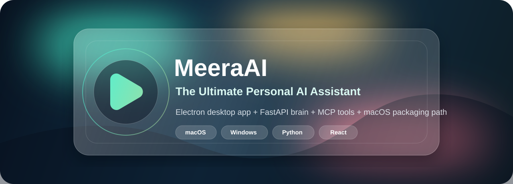

<p align="center">
  
</p>

<h1 align="center">MeeraAI - The Ultimate Personal AI Assistant</h1>

<p align="center">
  <strong>A premium desktop AI assistant with a Python FastAPI backend, Electron/React interface, MCP tooling, document intelligence, and a clear macOS development path.</strong>
</p>

<p align="center">
  
  
  
  
</p>

<p align="center">
  
</p>

## Snapshot

| Area | Stack | Status |
| --- | --- | --- |
| Assistant backend | Python, FastAPI, Uvicorn | Primary API in `Meera.py` |
| Desktop shell | Electron, TypeScript | macOS and Windows package scripts included |
| Interface | React, Vite, CSS | Premium glass-style desktop UI |
| Intelligence | Local/remote model plumbing, RAG, document tools | Configured through model manifests and backend services |
| Integrations | MCP servers, browser/search support | Local MCP config templates included |
| Distribution | Electron Builder | Windows package flow and macOS package flow available |

## Visual Identity

| App Brand | Interface Atmosphere | Desktop Packaging |
| --- | --- | --- |
|  |  |  |

## What MeeraAI Does

| Capability | Description |
| --- | --- |
| Conversational assistant | Runs a full assistant backend with chat, streaming responses, model routing, and long-running tool workflows. |
| Desktop productivity | Ships as an Electron desktop app with native window controls, packaged build flows, and a polished visual system. |
| Documents and knowledge | Supports uploads, extraction, search, RAG-style document workflows, and file-aware assistant behavior. |
| Model management | Includes local model manifest support, GGUF-oriented settings, and remote backend dependency profiles. |
| MCP tools | Includes MCP server support for extending MeeraAI with external tools and local automation. |
| macOS migration | Includes macOS backend install script and Electron Builder mac package targets for Intel, Apple Silicon, and universal builds. |

## Architecture

| Layer | Path | Purpose |
| --- | --- | --- |
| Core API | `Meera.py` | FastAPI app, assistant orchestration, model/runtime handling, file workflows, and service endpoints. |
| Desktop app | `desktop_frontend/` | Vite + React UI and Electron desktop runtime. |
| Electron runtime | `desktop_frontend/electron/` | Main process, preload bridges, desktop lifecycle, and OS integration points. |
| Build scripts | `desktop_frontend/scripts/` | Dependency setup, logo sync, Electron build helpers, and macOS backend install flow. |
| MCP package | `MCP/` | Tool server packages used by the assistant. |
| Installer | `installer/` | Windows installer shell and packaging assets. |
| Config templates | `config/`, `mcp_servers.example.json` | Shareable examples without local secrets or machine-specific paths. |

## macOS Development

Install these on the Mac first:

| Requirement | Recommended Version |
| --- | --- |
| macOS | Current stable macOS release |
| Xcode Command Line Tools | `xcode-select --install` |
| Node.js | 20 or newer |
| Python | 3.10 or newer |
| Git | Latest stable |

Clone and install:

```bash
git clone https://github.com/rockstar5656/MeeraAI---The-Ultimate-Personal-AI-Assistant.git
cd MeeraAI---The-Ultimate-Personal-AI-Assistant
cd desktop_frontend
npm install
```

Prepare the backend runtime:

```bash
./scripts/install-backend-mac.sh "$(pwd)" "$HOME/Library/Application Support/MeeraAI/backend"
```

Run MeeraAI for development:

```bash
# Terminal 1, from the repository root
python3 Meera.py --api --port 8000

# Terminal 2, from desktop_frontend
npm run dev
```

## macOS Packaging

| Command | Output Target |
| --- | --- |
| `npm run package:mac` | macOS DMG/ZIP package |
| `npm run package:mac:intel` | Intel Mac build |
| `npm run package:mac:silicon` | Apple Silicon build |
| `npm run package:mac:universal` | Universal macOS build |

```bash
cd desktop_frontend
npm run package:mac
```

The current macOS package configuration is suitable for local development builds. For public distribution, add an Apple Developer certificate, enable hardened runtime/signing, and notarize the final release.

## Windows Development

```powershell
python Meera.py --api --port 8000

cd desktop_frontend
npm install
npm run dev
```

Windows packaging:

```powershell
cd desktop_frontend
npm run package
```

## Repository Hygiene

| Kept In Git | Ignored Locally |
| --- | --- |
| Source code, package manifests, app assets, setup docs, build scripts | `.env`, local tokens, databases, uploads, screenshots, `node_modules`, virtualenvs, build outputs, installers, model weights |
| `config/huggingface.example.json` | `config/huggingface.json` |
| `mcp_servers.example.json` | `mcp_servers.json`, `data/mcp_servers.json` |

## Local Configuration

Create local config from the templates:

```bash
cp config/huggingface.example.json config/huggingface.json
cp mcp_servers.example.json mcp_servers.json
```

Large model files should stay outside Git. Use download scripts, release assets, or external model storage for `.gguf`, `.safetensors`, `.onnx`, and similar files.

## Verification

These checks passed during repository preparation:

| Check | Result |
| --- | --- |
| `python -m py_compile Meera.py` | Passed |
| `npm run build` from `desktop_frontend/` | Passed with non-fatal bundle-size/runtime asset warnings |

## Roadmap

| Phase | Focus |
| --- | --- |
| 1 | Stabilize macOS development environment and backend dependency setup. |
| 2 | Replace Windows-specific paths with cross-platform path helpers where needed. |
| 3 | Add signed and notarized macOS release pipeline. |
| 4 | Split large frontend bundles with dynamic imports for faster startup. |
| 5 | Add automated smoke tests for backend health, Electron boot, and packaged app launch. |

## License

See `LICENSE`.
